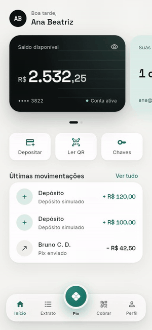

# Wallet Ledger Mobile

[](https://github.com/Mavoxweb/wallet-ledger-mobile/actions/workflows/ci.yml)


App do correntista do **Wallet Ledger**, em Flutter: saldo, Pix por chave, extrato, QR code de cobrança, chaves Pix e depósito simulado.

O foco é o mesmo da API: **não errar com dinheiro**. Um Pix repetido por falha de rede não é cobrado duas vezes, um toque duplo em "Confirmar" não envia duas transferências, e o que a tela mostra vem sempre do servidor.

> Faz parte do **Wallet Ledger**, um sistema com três repositórios:
> - [wallet-ledger-api](https://github.com/Mavoxweb/wallet-ledger-api): API (.NET), livro-razão de partidas dobradas
> - **wallet-ledger-mobile**: este app (Flutter)
> - **wallet-ledger-backoffice**: painel da operação em Angular *(em construção)*

<p align="center">
  
  
  
</p>

## Sumário

- [O que o app faz](#o-que-o-app-faz)
- [Destaques técnicos](#destaques-técnicos)
- [Arquitetura](#arquitetura)
- [Como rodar](#como-rodar)
- [Como testar](#como-testar)
- [Download](#download)
- [Decisões (ADRs)](#decisões-adrs)

---

## O que o app faz

| Tela | O que tem |
|---|---|
| **Entrada** | Splash nativo, animação do símbolo, login e cadastro |
| **Início** | Saldo (com ocultar), cartões deslizantes, atalhos e últimas movimentações |
| **Extrato** | Agrupado por dia (horário de Brasília), filtros de entrada e saída, paginação por cursor |
| **Pix** | Chave → valor → confirmação (com biometria, se houver) → comprovante animado |
| **Cobrar** | QR code BR Code com valor opcional, copiar e compartilhar o código |
| **Ler QR** | Câmera ou código colado: abre o Pix já preenchido, com o valor travado |
| **Perfil** | Chaves Pix (até 5), depósito simulado, sair |

## Destaques técnicos

- **Idempotência no app.** A `Idempotency-Key` do Pix nasce na confirmação e é reusada ao tentar de novo **o mesmo pedido**. Se a rede cair depois de a API debitar, a nova tentativa devolve o mesmo comprovante, sem debitar outra vez. O depósito segue a mesma regra.
- **Concorrência no Bloc.** O `PixTransferBloc` processa eventos em fila (`sequential()`), então um toque duplo não atravessa o fluxo.
- **Dinheiro em centavos.** Valores são `int` do começo ao fim. O campo de valor funciona como maquininha: cada dígito empurra os anteriores.
- **BR Code verificado.** O leitor confere o CRC16 do QR antes de aceitar. O teste usa o mesmo vetor oficial do Banco Central que os testes da API.
- **Cliente gerado do contrato.** O pacote HTTP é gerado do `openapi.json` da API, e o CI falha se o código commitado estiver desatualizado.
- **Erros traduzidos.** Cada código da API (`insufficient_funds`, `pix_key_taken`…) tem uma mensagem em português que diz o que aconteceu e o que fazer.
- **Acessibilidade.** Rótulos de leitor de tela, texto em 2x sem quebrar layout e movimento reduzido quando o sistema pede.

## Arquitetura

```
lib/
├── app/        roteamento (go_router) e injeção dos repositórios
├── core/       erros, rede, tema, movimento, dinheiro, widgets comuns
└── features/   uma pasta por fluxo
    └── pix/
        ├── data/   repositório: traduz o cliente gerado para modelos do app
        ├── bloc/   estado do fluxo (eventos → estados)
        └── view/   widgets das etapas
packages/
└── wallet_ledger_api/   cliente gerado (não editar à mão)
```

```
Tela ──evento──▶ Bloc/Cubit ──▶ Repositório ──▶ Cliente gerado (Dio) ──▶ API
  ◀──estado────┘                  ◀── Failure (ApiFailure / NetworkFailure / ValidationFailure)
```

Telas só desenham. A regra (reuso da chave, limites, etapas do Pix) mora nos Blocs, que são testados com repositórios falsos. Depois de um Pix, um depósito ou uma mudança de chave, um `Stream` de eventos da conta faz o Início e o Extrato recarregarem.

## Como rodar

Pré-requisitos: Flutter 3.50 e a [API](https://github.com/Mavoxweb/wallet-ledger-api) rodando no Docker (`docker compose up` no repositório da API, que sobe em `http://localhost:8080` com dados de demonstração).

```bash
flutter pub get
flutter run -d chrome --dart-define=API_BASE_URL=http://localhost:8080
```

Usuários de demonstração (criados pela API em ambiente de desenvolvimento): `ana@walletledger.dev` e `bruno@walletledger.dev`, senha `Demo@1234`.

Para regenerar o cliente depois de mudar `contract.version`:

```bash
bash tool/generate_api.sh
```

## Como testar

```bash
flutter analyze
flutter test
```

134 testes: Blocs e Cubits (`bloc_test` + `mocktail`), regras puras (BR Code, valor, agrupamento por dia) e testes de widget dos fluxos completos, incluindo texto em 2x e movimento reduzido.

## Download

Cada versão publicada em [Releases](https://github.com/Mavoxweb/wallet-ledger-mobile/releases) traz:
- `wallet-ledger.apk`: o app para Android;
- `wallet-ledger-web.zip`: o build web, para servir em qualquer servidor estático.

O app aponta para `http://localhost:8080` por padrão. Para outro endereço, gere o build com `--dart-define=API_BASE_URL=...`.

## Decisões (ADRs)

- [0001 — Estado com Bloc e Cubit, um por fluxo](docs/adr/0001-bloc.md)
- [0002 — Cliente HTTP gerado do contrato da API](docs/adr/0002-cliente-gerado.md)
- [0003 — Movimento com propósito e movimento reduzido](docs/adr/0003-movimento.md)

---

Projeto de portfólio: o dinheiro é fictício.
