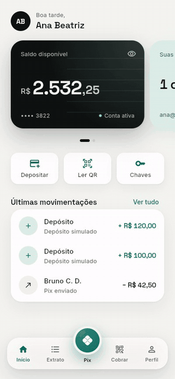
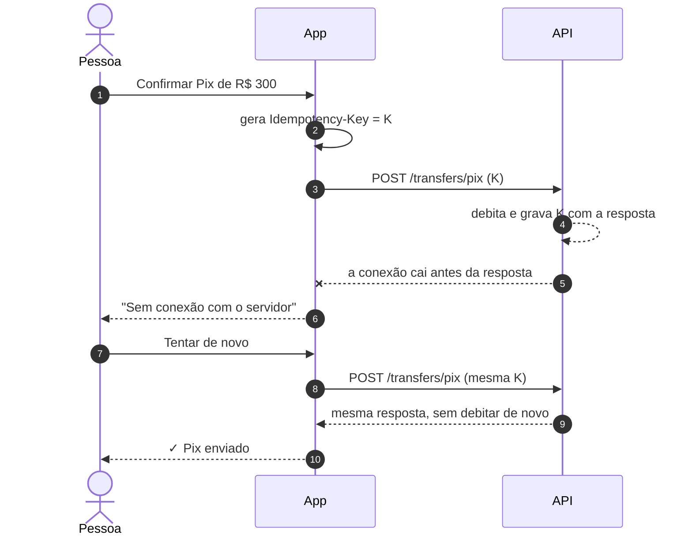

# Wallet Ledger Mobile

[](https://github.com/Mavoxweb/wallet-ledger-mobile/actions/workflows/ci.yml)
[](https://github.com/Mavoxweb/wallet-ledger-mobile/releases/latest)


Um app de carteira digital em Flutter: saldo, Pix por chave ou QR code, extrato, cobrança e chaves Pix. Tudo isso conversando com uma [API .NET de verdade](https://github.com/Mavoxweb/wallet-ledger-api), com livro-razão de partidas dobradas.

> **Faz parte do Wallet Ledger**
> - [wallet-ledger-api](https://github.com/Mavoxweb/wallet-ledger-api): API .NET com razão de partidas dobradas, idempotência e auditoria
> - **wallet-ledger-mobile**: este app, em Flutter
> - [wallet-ledger-backoffice](https://github.com/Mavoxweb/wallet-ledger-backoffice): painel da operação em Angular (busca de contas, bloqueio, estorno, auditoria)

<p align="center">
  
  &nbsp;
  
  &nbsp;
  
</p>

---

## O momento que este app foi feito para resolver

Você toca em **Confirmar** num Pix de R$ 300, e a tela fica girando. O 4G cai. Aparece um erro de conexão.

O dinheiro saiu ou não saiu? Se você tentar de novo, paga duas vezes?

Esse momento é o coração do projeto. Neste app, a resposta é sempre a mesma: **tente de novo sem medo**. O pedido carrega uma `Idempotency-Key` que nasce na confirmação e é reaproveitada em cada nova tentativa. Se a API já tinha debitado, ela devolve o mesmo comprovante, e o dinheiro sai uma única vez.



Eu testei esse cenário de verdade, sem simular: parei a API no meio de um Pix, vi a tela de falha, subi a API de novo e toquei em "Tentar de novo". O saldo caiu uma vez só.

Uma regra decide quando a chave muda: se a pessoa voltar e trocar o valor, o destinatário ou a mensagem, é **outro pedido**, e nasce outra chave. O mesmo pedido, repetido, nunca gera dois débitos.

## As outras decisões que fazem diferença

**Um toque duplo não envia dois Pix.** O `PixTransferBloc` processa os eventos em fila (`sequential()` do `bloc_concurrency`). O segundo toque espera o primeiro terminar e encontra o fluxo já na etapa de envio.

**Dinheiro nunca é `double`.** Valores são centavos (`int`) da tela até a API. O campo de valor funciona como uma maquininha de cartão: digitar 2, 5, 9, 0 mostra R$ 25,90, sem vírgula para errar.

**O QR code é conferido antes de abrir o Pix.** O leitor valida o CRC16 do BR Code e recusa códigos adulterados. O teste usa o mesmo exemplo oficial do Banco Central que os testes da API, então os dois lados concordam sobre o que é um QR válido. Se o QR traz um valor, o Pix abre com o valor travado.

**Erros falam a língua de quem usa.** Cada código da API tem uma mensagem que diz o que aconteceu e o que fazer. `insufficient_funds` vira "Saldo insuficiente para este Pix. Confira o valor e tente de novo.", e não "Erro 422".

**A tela nunca inventa saldo.** Depois de um Pix, um depósito ou uma mudança de chave, um `Stream` de eventos da conta faz o Início e o Extrato buscarem os dados de novo no servidor.

**Confirmação só onde dói.** Remover uma chave Pix pede confirmação, porque outra pessoa pode cadastrar aquela chave depois. Sair da conta não pede. Quem pede confirmação para tudo ensina a pessoa a clicar "OK" sem ler.

**Movimento com propósito, e respeito a quem não quer movimento.** As animações têm tempos definidos num arquivo só (toque em 120 ms, troca de aba em 220 ms). Quando o sistema pede menos movimento, os deslizes viram fades. O app também funciona com texto em 200%.

## O que tem no app

| Tela | O que faz |
|---|---|
| **Entrada** | Splash nativo, animação do símbolo, login e cadastro |
| **Início** | Saldo com opção de ocultar, cartões deslizantes, atalhos e últimas movimentações |
| **Extrato** | Agrupado por dia no horário de Brasília, filtros de entrada e saída, rolagem infinita por cursor |
| **Pix** | Chave → valor → confirmação (com biometria, se o aparelho tiver) → comprovante animado |
| **Cobrar** | Gera o QR code BR Code, com valor opcional, para copiar ou compartilhar |
| **Ler QR** | Pela câmera ou colando o código; abre o Pix preenchido |
| **Perfil** | Chaves Pix (até 5), depósito simulado para testar, sair |

## Por dentro

Clean Architecture, com três camadas por feature:

```
presentation            domain (Dart puro)                 data
Tela ─▶ Bloc/Cubit ─▶ Caso de uso ─▶ Repositório (contrato) ◀── ApiRepositório ─▶ Cliente gerado ─▶ API
  ◀──estado──┘            ◀── Failure: Api / Network / Validation
```

- **Telas só desenham.** O comportamento mora nos Blocs e Cubits, e as telas só conhecem casos de uso (`SendPix`, `AddPixKey`…), nunca repositórios.
- **O domínio não sabe de onde vem o dado.** Entidades, contratos e casos de uso não importam Flutter, Dio nem o cliente gerado. Quem garante isso é um teste: se alguém importar, o CI quebra.
- **A regra mora no caso de uso.** O `AddPixKey` recusa a sexta chave sem chamar a API. Só o que depende da etapa do fluxo fica no Bloc, como o reuso da chave de idempotência no Pix.
- **O cliente HTTP é gerado** do contrato OpenAPI publicado pela API. Se a API mudar e o app não acompanhar, o CI quebra antes de alguém perceber em produção.

```
lib/
├── app/        rotas (go_router) e injeção de dependências
├── core/       erros, rede, tema, movimento, dinheiro, widgets comuns
└── features/   uma pasta por fluxo: domain/ (Dart puro) · data/ · presentation/
packages/
└── wallet_ledger_api/   cliente gerado (nunca editado à mão)
```

As decisões maiores estão registradas como ADRs:
[0001 — Bloc e Cubit](docs/adr/0001-bloc.md) ·
[0002 — Cliente gerado](docs/adr/0002-cliente-gerado.md) ·
[0003 — Movimento e acessibilidade](docs/adr/0003-movimento.md) ·
[0004 — Clean Architecture](docs/adr/0004-clean-architecture.md)

## Rodando na sua máquina

Você precisa do Flutter 3.50 e da [API](https://github.com/Mavoxweb/wallet-ledger-api) no Docker. Com `docker compose up` no repositório da API, ela sobe em `http://localhost:8080` com dados de demonstração.

```bash
flutter pub get
flutter run -d chrome --dart-define=API_BASE_URL=http://localhost:8080
```

Entre com `ana@walletledger.dev` ou `bruno@walletledger.dev` (senha `Demo@1234`). São duas contas fictícias criadas pela API no ambiente de desenvolvimento. Com as duas, dá para mandar Pix de uma para a outra e ver o extrato dos dois lados.

Se preferir não compilar nada, o [Release mais recente](https://github.com/Mavoxweb/wallet-ledger-mobile/releases/latest) traz o **APK para Android** e o **build web** em `.zip`. Os dois apontam para a API em `localhost:8080`.

## Testes

```bash
flutter analyze
flutter test
```

São 143 testes:
- arquitetura (o domínio não importa Flutter, Dio nem o cliente gerado; as telas não leem repositórios);
- regras puras e casos de uso (BR Code, campo de valor, agrupamento do extrato por dia, limite de chaves);
- Blocs e Cubits com `bloc_test` e `mocktail` (reuso da chave de idempotência, limite de chaves, teto do depósito);
- testes de widget dos fluxos completos, inclusive com texto em 200% e movimento reduzido.

Quando corrijo um bug, o teste vem antes da correção, e eu confiro que ele falha sem ela.

## Limites honestos

- **O dinheiro é fictício.** O Pix acontece entre contas deste sistema, sem integração com o Banco Central. Um app de banco reconhece o QR code gerado aqui, mas não consegue pagá-lo.
- **O depósito é simulado**, até R$ 1.000 por vez e R$ 5.000 por dia, só para dar saldo nas contas de teste.
- **Ainda não há demo online.** Por enquanto, o app aponta para a API local. A publicação da API com PostgreSQL serverless está nos próximos passos.

---

## Sobre este projeto

Na [API](https://github.com/Mavoxweb/wallet-ledger-api) eu cuidei para o dinheiro nunca sumir nem duplicar no servidor. Mas a pessoa não vê o servidor. Ela vê um botão, uma tela girando e, às vezes, uma mensagem de erro na hora mais tensa. Este app é a outra metade da mesma ideia: levar as garantias do back-end até o dedo de quem toca em "Confirmar".

Foi também meu projeto para aprender Dart e Flutter a fundo, e não só o suficiente para fazer telas bonitas. Cada parte que não é óbvia (a fila de eventos do Bloc, a vida útil da chave de idempotência, por que existem um splash nativo **e** uma animação de entrada) está comentada no código ou registrada num ADR, porque eu quero conseguir explicar cada linha.

Se você trabalha com apps financeiros e faria alguma coisa diferente, me conta. Vou gostar da conversa.

**Alex Marques** · Desenvolvedor Full Stack · Rio de Janeiro
[LinkedIn](https://www.linkedin.com/in/alex-marques-455089205) · [GitHub](https://github.com/Mavoxweb)
